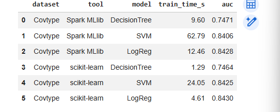
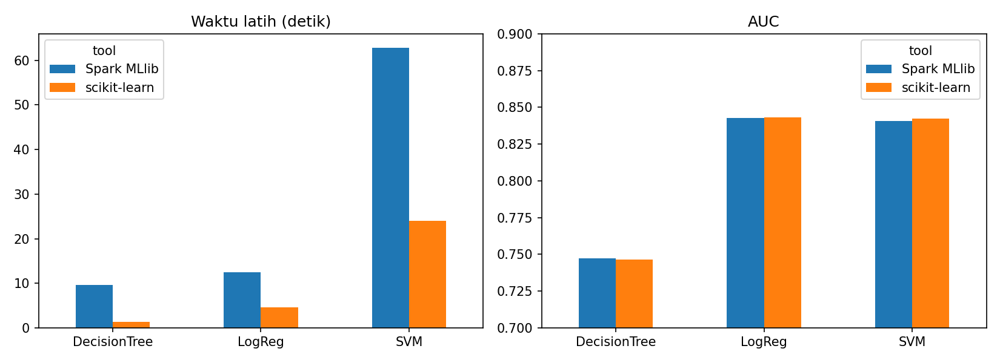

# Replikasi Parsial: Large Scale Data Analysis Using MLlib

Tugas Eksplorasi Mandiri Mahadata (IF25-40402)
Nama: Eka Putri Azhari Ritonga | NIM: 123140028 | Matakuliah: Mahadata

## Artikel yang direplikasi
Ali, A. H., Abbod, M. N., Khaleel, M. K., Mohammed, M. A., & Sutikno, T. (2021).
Large scale data analysis using MLlib. *TELKOMNIKA, 19*(5), 1735-1746.
https://doi.org/10.12928/telkomnika.v19i5.21059

Artikel membandingkan Spark MLlib dengan MOA pada decision tree, SVM, dan
logistic regression, dengan metrik waktu komputasi dan AUC.

## Ruang lingkup replikasi
- Replikasi **parsial**: satu dataset (Covtype, 2 kelas), mode lokal.
- Hasil artikel hanya berupa grafik, jadi perbandingan dengan artikel bersifat kualitatif.
- Variasi dari artikel: pembanding **scikit-learn** menggantikan MOA.

## Data
- Forest Covertype (UCI), diunduh lewat `sklearn.datasets.fetch_covtype`.
- 581.012 baris, 54 fitur. Label biner: kelas 1 = 1, lainnya = 0
  (proporsi 36,5% : 63,5%).
- Pembagian data 70/30, seed 42 (latih 406.550, uji 174.462 pada Spark).

## Metode
| Model | Parameter Spark MLlib | scikit-learn |
|---|---|---|
| Decision Tree | maxBins 32, maxDepth 6, minInfoGain 0,15, entropy | criterion entropy, max_depth 6, min_impurity_decrease 0,15 |
| SVM | LinearSVC, maxIter 1000 | LinearSVC + StandardScaler, max_iter 1000, dual=False |
| Logistic Regression | maxIter 1000 | LogisticRegression + StandardScaler, max_iter 1000 |

Waktu latih adalah rata-rata 3 kali jalan. AUC dihitung pada data uji.

## Hasil (Covtype)
| Model | Spark waktu (s) | Spark AUC | sklearn waktu (s) | sklearn AUC |
|---|---|---|---|---|
| Decision Tree | 9,60 | 0,7471 | 1,29 | 0,7464 |
| SVM | 62,79 | 0,8406 | 24,05 | 0,8425 |
| Logistic Regression | 12,46 | 0,8428 | 4,61 | 0,8430 |

Ringkasan: AUC kedua alat hampir sama (selisih maks. ~0,002). scikit-learn lebih
cepat pada semua model karena Spark mode lokal di satu mesin menanggung overhead
penjadwalan; keunggulan Spark diharapkan muncul pada data lebih besar atau klaster.

## Keterbatasan
- Hanya satu dataset; satu mesin (Google Colab), bukan klaster.
- MOA diganti scikit-learn, sehingga tidak sebanding langsung dengan artikel.
- Artikel memakai MLlib 2.0, replikasi ini memakai PySpark 4.0.4, sehingga
  perilaku dan performa bisa berbeda.
- `randomSplit` Spark dan `train_test_split` scikit-learn menghasilkan split berbeda.
- `minInfoGain` dan `min_impurity_decrease` tidak persis setara.
- `minInfoGain` 0,15 kemungkinan membuat pohon sangat dangkal (AUC DT rendah).

## Isi repositori
- `mahadata_spark_mllib.ipynb`: notebook eksperimen
- `hasil_covtype.csv`: tabel hasil
- `hasil_covtype.png`: grafik hasil
- `requirements.txt`: daftar pustaka

## Cara menjalankan
1. Buka `mahadata_spark_mllib.ipynb` di Google Colab.
2. Jalankan sel 1 sampai 4 berurutan.

Lingkungan: Python 3.13.16, PySpark 4.0.4 (Google Colab).
